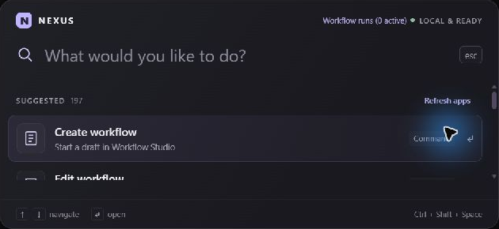
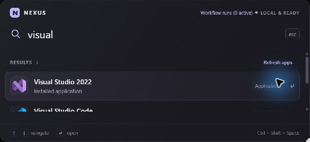
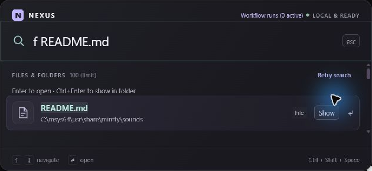
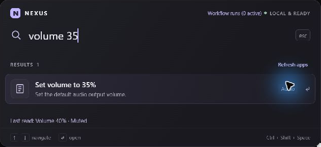
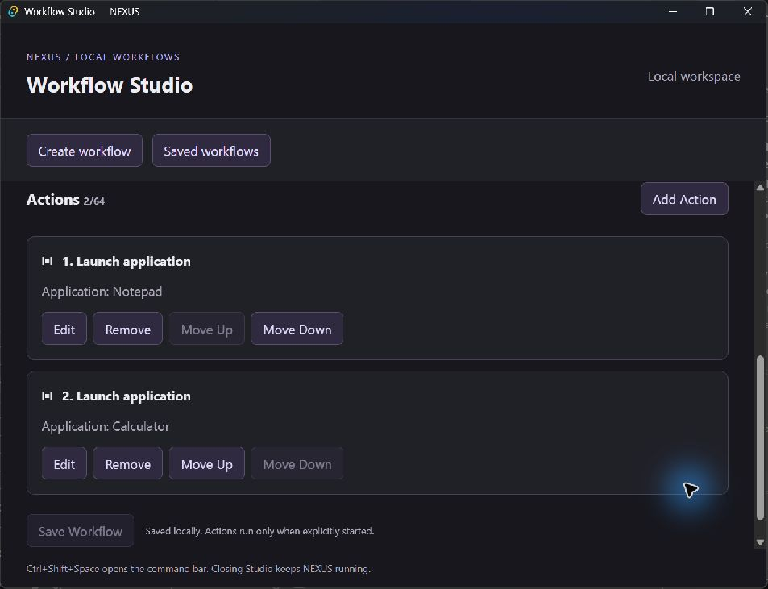
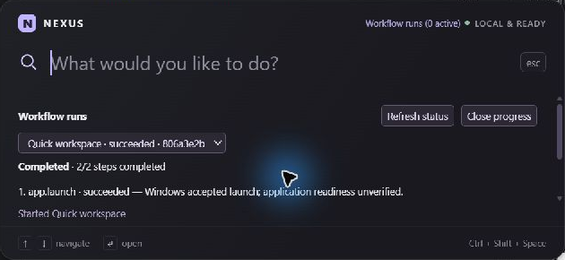
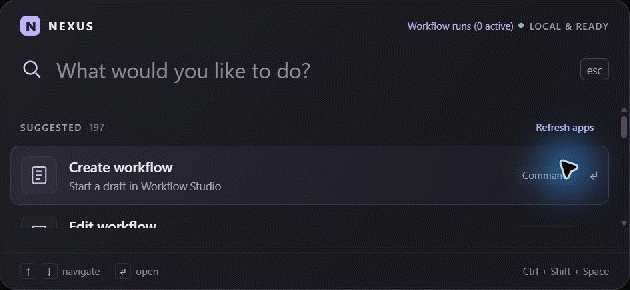

# NEXUS

**Your apps, files, and everyday Windows actions. One command bar.**

A local-first desktop launcher for Windows 11.

[Explore](#less-searching-more-doing) · [Install](#install) · [Quick start](#make-it-a-habit) · [Documentation](#go-deeper)

 

**Press <kbd>Ctrl</kbd> + <kbd>Shift</kbd> + <kbd>Space</kbd>. Type. Go.**

Opening an app, finding a document, changing the volume, and getting a workspace ready
usually means visiting several different places. NEXUS brings those everyday tasks
into a small, keyboard-friendly bar that appears when you need it and gets out of your way.

No account, API key, subscription, or AI model is required. Once set up, its features
work locally without an internet connection.

> **Current status:** v0.5.1 is a release candidate. Installers have been built locally;
> publication is on hold. Installed-app and upgrade acceptance
> checks remain pending. [See the verification record.](docs/verification/V051_VERIFICATION.md)

## Less searching. More doing.

### Find the app you meant

Search installed desktop and Microsoft Store apps by name. NEXUS shows their real
icons, handles partial names and small typos, and uses your successful launches to
help break ties. Select a result and press <kbd>Enter</kbd>.

  

### Get straight to your files

Type `f ` followed by a filename or part of a path. Open a document in its default
app, open a folder in Explorer, or use <kbd>Ctrl</kbd> + <kbd>Enter</kbd> to reveal
the selected item. Matching text is highlighted so results are easy to scan.

File search uses your local **Everything** index and requires the optional setup below.

  

### Keep Windows controls within reach

Set the volume, make a relative adjustment, mute or unmute, and check the current
audio state. Jump to Sound, Wi-Fi, Bluetooth, or Display settings without navigating
through menus. Lock is available directly; sleep asks for confirmation.

Successful volume and mute changes also show a brief NEXUS audio overlay.

  

### Build a routine once. Run it by name.

**Workflow Studio** lets you combine supported actions into an ordered routine:
launch apps, open documents and folders, adjust audio, or open a Settings page.
Give it a name and optional aliases, arrange the steps, and save it on your PC.
Edit or rename it later; unsaved changes are protected when you leave the editor.

  

Type `w ` to browse saved workflows, or `w quick` to find one by name or alias.
The **Workflow runs** view shows completed steps, failures, and cancellation.
Workflow lock and sleep steps must come last and require separate approval for each run.

  

<strong>Watch a short launcher demonstration</strong>

  

The animation uses real captured UI states, with pauses adjusted for readability.
Quick workspace is demonstration data created for these captures; it is not a bundled template.
[Capture details](docs/verification/README_VERIFICATION.md).

## Install

**Windows 11 · x64 · Microsoft Edge WebView2 Runtime**

A public installer download is **not available yet**. Check the repository's
[Releases page](https://github.com/ishanpati/Nexus/releases) for published packages.
The filenames below describe the locally built candidate, not downloadable assets.

When you have a candidate installer:

1. Close NEXUS before installing or upgrading. Back up saved workflows before an upgrade.
2. Run **`nexus_0.5.1_x64-setup.exe`**, or use **`nexus_0.5.1_x64_en-US.msi`**.
   Choose one format. The installers are unsigned, so Windows may report an unknown publisher.
3. Launch **NEXUS** from the Start menu, then press <kbd>Ctrl</kbd> + <kbd>Shift</kbd> + <kbd>Space</kbd>
   whenever you need the bar.

WebView2 is required. Setup can download it if it is missing; install it beforehand
for offline setup. End users do not need Node.js, Rust, a source checkout, or ChatGPT.

<strong>Enable file search with Everything</strong>

Application search, Windows controls, and workflows work without Everything.
To add indexed file and folder search:

1. Install the [Everything desktop client](https://www.voidtools.com/downloads/)
   and its separate [ES command-line tool](https://www.voidtools.com/support/everything/command_line_interface/).
2. Run Everything in your Windows session and let its index become ready.
   The Everything service alone is insufficient.
3. Add the folder containing `es.exe` to your Windows **user Path**, or create a
   **user environment variable** named `NEXUS_ES_PATH` whose value is the full path
   to `es.exe`, without enclosing quote characters. Find these controls by searching
   Start for **Edit environment variables for your account**.
4. Fully quit and restart NEXUS, then try `f meeting notes` with a filename you know.

Everything and ES are not bundled. NEXUS uses the default Everything instance;
ES 1.1.0.38 was verified in development. [Setup and troubleshooting](docs/features/file-search/FILE_SEARCH.md#setup).

Building it yourself? Start with the [development instructions](docs/USER_GUIDE.md#development-and-release-build).

## Make it a habit

| You want to… | Type in NEXUS |
| --- | --- |
| Open an app | Its name, such as `calculator` or `visual` |
| Open a fresh Notepad | `open notepad` |
| Find a file or folder | `f meeting notes` |
| Set or adjust volume | `volume 35`, `volume +10`, `volume down` |
| Mute, unmute, or read audio state | `mute`, `unmute`, `audio status` |
| Open a Windows Settings page | `sound settings`, `wifi settings`, `bluetooth settings`, `display settings` |
| Lock or request sleep | `lock`, `sleep` |
| Create or manage a routine | `create workflow`, `edit workflow` |
| Find your saved routines | `w ` or `w quick` after saving a matching name or alias |

Typing only searches or previews. Actions run when you activate a result.

| Shortcut | Action |
| --- | --- |
| <kbd>Ctrl</kbd> + <kbd>Shift</kbd> + <kbd>Space</kbd> | Show or hide NEXUS |
| <kbd>↑</kbd> / <kbd>↓</kbd> | Select a result |
| <kbd>Enter</kbd> | Run or open the selected result |
| <kbd>Ctrl</kbd> + <kbd>Enter</kbd> | Reveal a file result in Explorer |
| <kbd>Esc</kbd> | Clear the query and dismiss the launcher |
| <kbd>Alt</kbd> + <kbd>F4</kbd> in the launcher | Quit when idle; hide while a workflow is running |

The launcher also hides when you switch to another app. Drag its header to move it
temporarily; the next summon places it on the active monitor. Closing Workflow Studio
keeps NEXUS running. Use **Workflow runs** to return to progress after dismissing the bar.

## Built for your desktop

NEXUS runs as a Windows app with its interface bundled inside it. React and TypeScript
render the launcher and Studio; a Rust backend validates requests and talks to Windows.
Tauri 2 connects the two using Microsoft's WebView2 runtime.

| Part | Technology |
| --- | --- |
| Desktop application | Tauri 2 + WebView2 |
| Interface | React 19 + TypeScript |
| Windows integration | Rust + native Windows APIs |
| Saved workflows | Local SQLite database |
| Optional indexed file search | Everything + ES |

App discovery uses Windows' application catalogs. Files are found through the local
Everything index. Workflows stay on your PC, and production runs without a development
server or cloud backend. NEXUS dispatches supported actions rather than interpreting
your text as a shell command. [How it fits together](docs/architecture/ARCHITECTURE.md).

## Before you rely on it

- **Release acceptance is still in progress.** Local build and screenshot checks do
  not establish installer, upgrade, or every Windows hardware/policy scenario.
- **Search has boundaries.** Portable apps outside Windows' catalogs may not appear.
  File search covers indexed names and paths, not file contents or advanced Everything syntax.
- **Workflows run in sequence.** No scripts, custom executable arguments, delays,
  parallel steps, or waiting for an app to finish loading. Launch success means Windows
  accepted the request; foreground activation is verified separately and can be denied. Cancellation stops future steps; completed actions are not undone.
- **History is session-only.** Active runs do not resume after exit. Closing progress
  does not cancel a run. Workflow file steps reject executable, script, and other sensitive types.
- **Data needs a backup.** Workflows are stored in plaintext at
  `%LOCALAPPDATA%\com.nexus.launcher\workflows.sqlite3`, with no encryption or sync.
  Development and installed builds share this location. [Backup and restore instructions](docs/USER_GUIDE.md#workflow-data-and-backup).
- **Distribution is early.** No automatic updates, automatic startup, or tray icon.
  If the global shortcut conflicts with another app, launching NEXUS again summons it.

Detailed security and release caveats, including the current disabled content security
policy, are recorded in [v0.5 verification](docs/verification/V051_VERIFICATION.md#known-limitations-and-remaining-risks).

## Go deeper

| Guide | What you'll find |
| --- | --- |
| [Documentation index](docs/README.md) | Feature specifications, developer contracts, and historical reports |
| [Release notes](docs/releases/README.md) | Version history, installation/upgrade guidance, and v0.5 publication readiness |
| [User guide](docs/USER_GUIDE.md) | Full controls, workflow instructions, backup, and development setup |
| [Architecture](docs/architecture/ARCHITECTURE.md) | Local data flow, native boundaries, and module responsibilities |
| [Changelog](CHANGELOG.md) | Changes across NEXUS milestones |
| [v0.5 verification](docs/verification/V051_VERIFICATION.md) | Executed checks and remaining release acceptance work |

Development-stage documents include historical scope notes; use the changelog and
current verification report for release status. For bug reports, include your Windows
version, NEXUS version, steps to reproduce, and the error shown. Remove private paths
from screenshots and logs before sharing them in [Issues](https://github.com/ishanpati/Nexus/issues).

**Licensing:** this repository currently has no license file. Public source availability
does not grant an open-source license; reuse and redistribution terms have not been specified.
