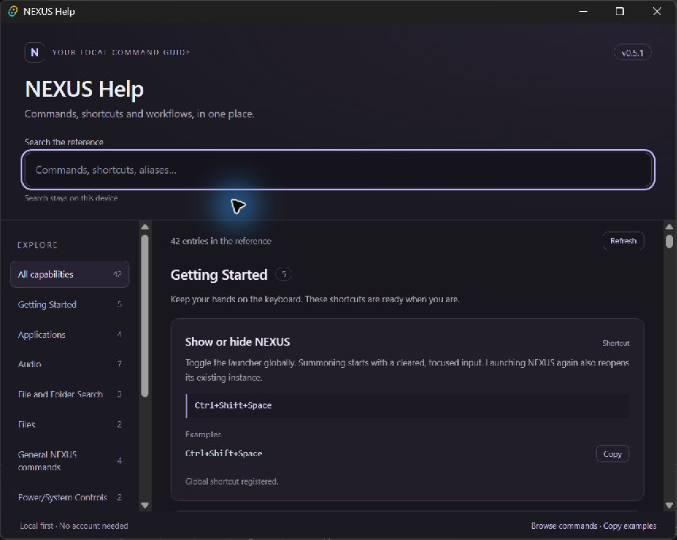

# v0.5.2 Stage B: interactive Help Center

Implemented on `feature/help-center`. Package/installer versions remain 0.5.1;
the header displays the actual running version, not a future release number.

## Behavior and data flow

`help` is an ordinary typed registration in `src/commands.ts`. The existing ranker
matches `hel`; Enter and mouse activation dispatch the selected immutable row's
`help` ID through `commandService.ts`, which invokes only `open_help_center`.
The original discovery ID `nexus.help` is retained via registration metadata.
The independent Stage A placeholder was removed, so there is only one Help entry.

Rust lazily creates one native `help-center` webview with local
`index.html?help-center` assets and title **NEXUS Help**. Its target inner size is
850×650 logical pixels, with 620×440 minimums reduced when necessary for small
work areas. Physical placement accounts for monitor origin and scale; reserved
space accommodates native decorations. It is resizable and uses the standard
Windows title bar with a dark theme. It does not register another global shortcut.

Help reuses Studio's existing `activate` sequencing helper and the shared native
launch admission guard. The guard serializes creation and suppresses launcher
blur dismissal during opening. Rust waits up to eight seconds for the mounted
React view to acknowledge readiness before showing/focusing Help. Only successful
open/focus reaches the existing launcher clear/hide lifecycle. Errors restore
the launcher without emitting its reset-on-summon event, preserving the failed
query. A failed readiness handshake destroys the failed Help instance so the next
open can retry. As with Studio, this readiness deadline does not bound a hung
native WebView creation call.

Closing Help hides its retained window; it does not quit NEXUS. Reopening restores
a minimized window, shows/focuses it, focuses search and refreshes local metadata.
Its query/category filters persist. Help can coexist with Studio and active runs;
the launcher retains its existing global-shortcut, blur, draft and quit behavior.
The retained webview uses memory after first opening, matching Studio's lifecycle;
Help creates no window, listeners, timers or polling at launcher startup.

`main.tsx` routes Help independently from the launcher, Studio and audio overlay.
The Help component and CSS are lazy-loaded into separate Vite chunks. Generic
`HelpCard` and `HelpNavigation` components render the authoritative
`createCommandDiscoverySnapshotService(invoke)` result, including all 42 current
capabilities. `applicationVersion` comes from Rust's `app.package_info().version`.
There is no manually maintained React command inventory or category enum.

Search normalizes case and whitespace and matches names, syntax, aliases,
descriptions, examples and category text. Exact names/syntax and name/syntax
prefixes outrank incidental text matches. A selected category intersects the
search. Empty search groups entries by dynamic category; Getting Started appears
first with the actual configured launcher chord at the front of the catalog.
Search results retain ranking rather than being regrouped. Reset filters clears
both filters and returns focus to search. Loading, empty catalog, no results and
error/retry states are separate. Old asynchronous metadata reads are discarded.

Cards display supplied descriptions, syntax, aliases, examples, prerequisites,
workflow compatibility and relevant availability. Expandable details render
generic Rust parameter schemas (including limits, choices, required/default
values), confirmations and final-step restrictions. Launcher and workflow
confirmation remain separately labelled; immediate launcher lock never implies
unattended workflow lock. Missing optional fields are tolerated. Unknown categories
render with the same components. Private IDs, schema versions and native handlers
are not shown as product instructions.

## Security, permissions and copying

Help imports only descriptive services. Browsing, searching, filtering, expanding
details and copying never invoke a command/workflow executor. Text renders through
React without HTML interpretation. Clipboard writes use the standard WebView2
`navigator.clipboard.writeText()` API from an explicit Copy click; the exact
example string, including whitespace, is passed unchanged. It never reads clipboard
contents. Brief accessible feedback reports success or gives a Ctrl+C fallback
on failure; generations prevent an obsolete completion replacing newer feedback.

The scoped `help-center` capability grants only event listen/unlisten for the
window's shown notification. No clipboard plugin, shell, filesystem, microphone,
network, broad window-control or app-exit permission is added. Rust restricts
open IPC to the main window and readiness IPC to Help. The existing read-only
discovery endpoint returns schemas and prerequisite status, never executors.
No npm/Cargo dependencies, lockfiles, database schemas or version fields change.

## Verification

Targeted frontend checks passed: 37 tests across Help, command discovery, command
matching, selected-result lifecycle and Studio integration. Nine new Help tests
cover exact/partial selection and failure ordering, search fields/ranking,
category intersection, hidden entries, temporary command/category registration,
schema presentation, exact copying and write failure, authoritative version,
the actual Help transport, and generic React card/navigation rendering. Render
tests also cover missing optional metadata and escaped HTML-like text. Temporary
test registrations are removed in `finally` and do not ship.

Two native Help tests passed for caller-label restrictions and logical sizing on
normal, scaled-equivalent and small work areas. Shared Studio activation tests
exercise create/reuse, readiness/focus ordering and creation/readiness/focus failure
paths. Existing suites cover launcher success/error, native validation, workflows,
app activation, file search and Windows controls without invoking lock or sleep.

Native desktop checks on the embedded-assets Windows development build:

- `hel` + Enter opened Help; the launcher hid and the next summon had empty input.
- `help` + mouse selection focused the same native Help handle; no duplicate window.
- The actual IPC loaded all 42 entries and version 0.5.1.
- Searching `volume -10` found the Volume entry; combining it with Applications
  showed no results and a Reset filters control.
- Reference scrolling and example controls worked. Copying `volume -10` showed
  success feedback; Ctrl+V in Help search reproduced that exact text.
- Ctrl+Shift+Space summoned the launcher while Help stayed open.
- Workflow Studio opened alongside Help. Closing Help left Studio/NEXUS alive,
  and the global shortcut still summoned a cleared launcher afterward.
- The test process then quit through the normal launcher/Studio lifecycle without
  editing or deleting workflows or changing Windows audio/power state.

One initial build attempt failed because the prior test binary was launched while
linking, preventing Windows from replacing `nexus.exe`. Closing that test process
and rebuilding resolved it. This was a verification sequencing error.

Final automated checks (locked/offline Cargo, cached npm dependencies):

- Full frontend suite, with the `npm test` file set and Node options plus a TAP
  summary reporter: **122 passed**, zero failures.
- `cargo test --locked --offline --manifest-path src-tauri/Cargo.toml --all-targets`:
  **132 passed, two intentionally ignored**, zero failures. Ignored cases are
  the existing live-audio opt-in and subprocess fixture.
- Rust doctests passed (zero doctests).
- `cargo clippy --locked --offline --manifest-path src-tauri/Cargo.toml --all-targets`:
  passed with existing style warnings; no warnings in the new Help/discovery code.
- `cargo fmt --manifest-path src-tauri/Cargo.toml -- --check`, `git diff --check`,
  69 local documentation links, a Help executor-import audit and manifest/version
  preservation checks passed.
- `npm run tauri build -- --debug --no-bundle -- --locked --offline`, with
  `CARGO_NET_OFFLINE=true`: passed. Its `npm run build` hook completed TypeScript
  checking and the production Vite build. Help's UI (12.70 kB) and CSS (6.50 kB)
  are separate lazy chunks. Cargo emitted the existing profile-path warning;
  Git emitted normal LF/CRLF conversion notices.

The final embedded-assets build was launched again and its actual Help window
visually checked: 42 entries, version 0.5.1, the configured global chord first in
Getting Started, and simplified availability text. The screenshot above is from
that build, captured through the Windows computer-use tool without layout edits.

Remaining manual acceptance includes multiple monitors/mixed DPI, Windows scaling
changes while Help is open, installed/upgrade builds, forced native creation/focus
errors, clipboard-denied environments, a screen reader, and an explicitly
disconnected desktop session. Automated failure injection and offline builds do
not establish those desktop behaviors.

## Files

- UI/model: `src/components/HelpCenter.tsx`, `src/components/HelpCenter.css`,
  `src/helpCenter.ts`, `src/main.tsx`.
- Registration/services: `src/commands.ts`, `src/launcherCapabilities.ts`,
  `src/commandDiscovery.ts`, `src/capabilityMetadata.ts`,
  `src/services/commandService.ts`, `src/services/commandDiscoveryService.ts`.
- Native window/metadata: `src-tauri/src/help_center.rs`, `src-tauri/src/lib.rs`,
  `src-tauri/src/workflow_studio.rs`, `src-tauri/src/command_discovery.rs`,
  `src-tauri/capabilities/help-center.json`.
- Tests: `tests/helpCenter.test.mjs`, `tests/commands.test.mjs`,
  `tests/commandDiscovery.test.mjs`.
- Documentation: this report, the discovery architecture report, documentation
  index, user guide, root README, changelog and `docs/assets/help-center.jpg`.
